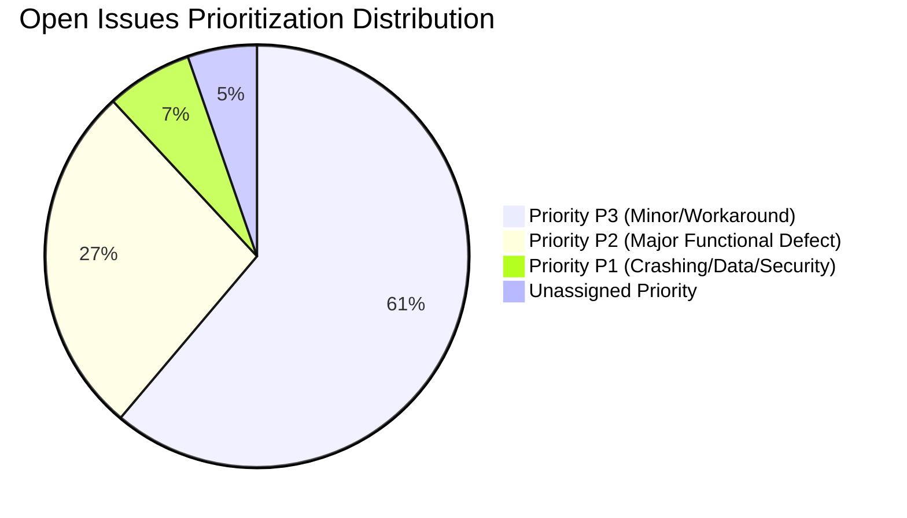

# Backlog Health & Prioritization Hygiene

## 1. Executive Summary
An audit of **200 recent pure issues** from the Metabase GitHub issue tracker reveals a highly structured categorization system that nonetheless suffers from severe **triage backlog accumulation**. While 94.7% of open issues eventually receive a priority tag, **77.6%** of open issues remain tagged with `.Needs Triage`, indicating that issues often receive preliminary tags from automated templates or community members without formal engineering review and acceptance.

---

## 2. Quantitative Telemetry

| Metric | Measured Value | Target Benchmark | Status |
|---|---|---|---|
| **Total Issues Sampled** | 200 | 200+ | Complete |
| **Open Issues vs Closed** | 152 Open (76.0%) / 48 Closed (24.0%) | N/A | Active Pipeline |
| **Prioritization Coverage** | **94.7%** (144 / 152 open issues) | > 85.0% | **Healthy** |
| **Triage Backlog Rate** | **77.6%** (118 / 152 open issues tagged `.Needs Triage`) | < 25.0% | **Critical Bottleneck** |
| **Unassigned Priority Share** | **5.3%** (8 / 152 open issues) | < 10.0% | **Healthy** |

---

## 3. Breakdown Analysis

### A. Priority Distribution
* **Priority P1 (Critical - 6.6%, 10 issues):** Setup crashes, security vulnerabilities, query correctness errors, and visual blockers. The relatively small percentage indicates effective gating of top-severity alarms.
* **Priority P2 (Major - 27.0%, 41 issues):** Significant functional defects with clumsy workarounds (e.g., Pivot table calculation errors after serialization).
* **Priority P3 (Minor / Workaround - 61.2%, 93 issues):** Cosmetic UI defects, URL slug inconsistencies, and non-blocking layout quirks. This group constitutes the majority of technical debt.
* **Unassigned Priority (5.3%, 8 issues):** Well within acceptable bounds for recent inbound community submissions.

### B. Issue Classification Mix
* **Type:Bug:** 126 issues (**63.0%**) - Highlights high incoming maintenance pressure on existing functionality.
* **Type:New Feature:** 38 issues (**19.0%**) - Customer and community requests for enhanced BI workflows.
* **Unassigned Type:** 36 issues (**18.0%**) - Inbound requests lacking clear classification tags.

---

## 4. Operational Diagnosis & Risk
1. **The `.Needs Triage` Accumulation Trap:** 
   Having 77.6% of open issues flagged with `.Needs Triage` represents a significant product-ops risk. It creates uncertainty around true backlog prioritization, prevents accurate sprint capacity planning, and risks burying high-severity regressions beneath a mountain of P3 cosmetic reports.
2. **Defect-Dominated Inflow:** 
   With bugs making up 63.0% of all submitted issues, engineering bandwidth is continuously challenged by defensive bug-fixing rather than strategic roadmap expansion.
