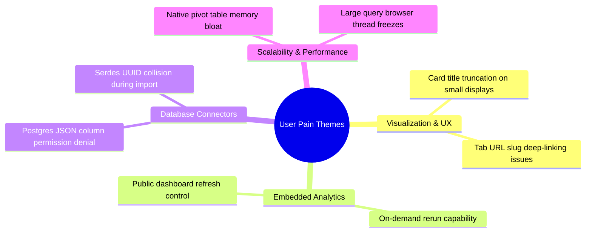

# Customer Feedback Themes & Voice-of-Customer Analysis

## 1. Executive Summary
Customer sentiment and user friction were evaluated by calculating a **Weighted Engagement Score** across recent issues:
$$\text{Engagement Score} = \text{Comments} + (2 \times \text{Reactions})$$
Reactions (👍, ❤️, 🚀) represent passive broad agreement, while comments reflect active engineering debate and operational friction.

---

## 2. Top User Friction Issues (Ranked by Engagement)

| Rank | Issue # | Title | Comments | Reactions | Priority | Type | Theme |
|---|---|---|---|---|---|---|---|
| **1** | **#84169** | *Dashboard tab URL slugs do not normalize multiple spaces or special characters* | 2 | 7 | P3 | Defect | **Dashboard UX & Deep-Linking** |
| **2** | **#83595** | *Let embedded questions rerun on demand when automatic reruns are disabled* | 10 | 1 | P1 | Feature | **Embedded Analytics Control** |
| **3** | **#84334** | *Number card title is hidden on small cards since v64, with no truncation override* | 3 | 3 | P1 | Defect | **Visual Layout & Card Usability** |
| **4** | **#83790** | *Postgres: JSON unfolding hits "permission denied" on columns user has access to* | 6 | 1 | P3 | Defect | **Data Connector & Permissions** |
| **5** | **#83885** | *Native pivot tables: pivots over 10k rows crash browser memory heap* | 5 | 1 | P2 | Defect | **Scalability & Browser Performance** |

---

## 3. Core Themes & Customer Pain Points

### A. Theme 1: Visualization & Usability Degradation (Card Titles & URL Slugs)
Users heavily engaged with layout issues where titles on number cards were cut off in recent minor versions (`#84334`), breaking executive summary dashboards. Similarly, broken URL slug normalization (`#84169`) impairs dashboard sharing across enterprise Slack channels.

### B. Theme 2: Enterprise Embedded Analytics Autonomy
Issue `#83595` highlights a prominent enterprise B2B use case: customers embedding Metabase dashboards into their own SaaS platforms require granular query execution controls (e.g., manual "Rerun" buttons when auto-refresh is suppressed to conserve warehouse credits).

### C. Theme 3: Data Connector & Permission Edge Cases
Database engine integrations (such as Postgres JSON unfolding in `#83790`) reveal pain points where database-level role permissions clash with Metabase's schema abstraction layer.
