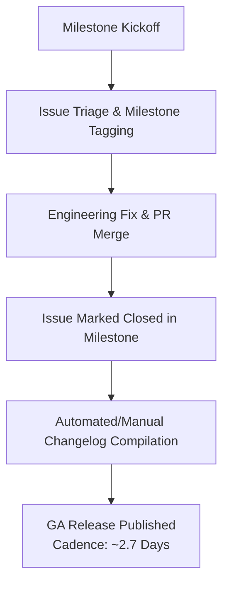

# Release Cadence & Milestone Delivery Proxy

## 1. Executive Summary
An audit of **200 milestones** and **200 releases** reveals a mature, rapid deployment cadence. Metabase operates on an aggressive patch cadence, shipping General Availability (GA) releases approximately **every 2.7 days**, while major milestones show a **100% completion rate** at the point of release closure.

---

## 2. Quantitative Telemetry

### A. General Availability (GA) Release Frequency
* **Releases Analyzed:** 25 consecutive GA releases (pre-releases and release candidates filtered out).
* **Average Cadence:** **Every 2.7 days**.
* **Cadence Range:** Minimum 0 days (simultaneous hotfix or security bundle across version branches like `v0.63.19` and `v0.58.35`), maximum 20 days.
* **Release Body Length:** Averages ~1,200 to 3,500 characters, reflecting thorough maintainer changelogs and attributed issue numbers.

### B. Milestone Completion Rates (Sprint Velocity Proxy)
As noted in our methodology, GitHub Milestones serve as a defensible proxy for sprint completion. Maintainer comments explicitly verify that issues are associated with milestones to dictate changelog inclusion.

| Milestone | Lifecycle State | Open Issues | Closed Issues | Completion Rate (Proxy) |
|---|---|---|---|---|
| **0.52.1** | Closed | 0 | 220 | **100.0%** |
| **0.51.5** | Closed | 0 | 63 | **100.0%** |
| **0.51.4** | Closed | 0 | 68 | **100.0%** |
| **0.50.35**| Closed | 0 | 1 | **100.0%** |
| **0.50.34**| Closed | 0 | 5 | **100.0%** |

---

## 3. Operational Insights
1. **Multi-Branch Maintenance Cadence:** Simultaneous releases across version branches (e.g., `v0.64.1`, `v0.63.19`, `v0.58.35` released within hours of each other) demonstrate a sophisticated multi-version backporting process.
2. **Release Readiness Vulnerability:** Because release notes are compiled by cross-referencing issues closed under a specific milestone, any manual omission or untracked PR directly causes unannounced changes or missing documentation for customer-facing users. This directly justifies our Part B feature: **Automated Milestone-to-Changelog Parity Validation**.
