# Triage Speed & Resolution Cycle Time

## 1. Executive Summary
Analysis of resolution cycle times (creation to closure) across closed issues demonstrates strong triage velocity for urgent defects, contrasted with longer resolution cycles for complex functional regressions.

---

## 2. Cycle Time Telemetry by Priority

| Priority Tier | Closed Issues Analyzed | Average Days to Close | Operational Assessment |
|---|---|---|---|
| **Priority P1 (Critical)** | 12 | **4.1 days** | **High Velocity:** Urgent security and crash reports receive rapid patch resolution. |
| **Priority P2 (Major Functional)** | 8 | **9.3 days** | **Extended Latency:** Deep architectural or serialization bugs take over double the time of P1. |
| **Priority P3 (Minor / Workaround)** | 22 | **4.3 days** | **Targeted Batching:** Closed P3s represent quick cosmetic fixes addressed during routine polish passes. |
| **Priority Unassigned** | 6 | **1.7 days** | **Rapid Invalidation:** Mostly duplicates or invalid submissions closed upon first inspection. |

```mermaid
gantt
    title Resolution Cycle Time by Priority (Average Days)
    dateFormat X
    axisFormat %s d
    section Critical
    Priority P1 (4.1 days)       :0, 4
    section Major
    Priority P2 (9.3 days)       :0, 9
    section Minor
    Priority P3 (4.3 days)       :0, 4
    section Invalid/Quick Close
    Unassigned (1.7 days)        :0, 2
```

---

## 3. Product Operations Findings

1. **P2 Bottleneck:** P2 issues take an average of **9.3 days** to resolve, which is more than double the cycle time of P1 issues (4.1 days). This indicates that bugs impacting core user flows (such as pivot table rendering or database connector timeouts) encounter significant architectural friction or cross-team dependencies.
2. **The "Triage Debt" Disconnect:** While closed issues show rapid resolution once scheduled, the open backlog's **77.6% untriaged rate** proves that the primary bottleneck is not code resolution speed, but **intake triage latency** (the duration a ticket sits idle before an engineer is assigned).
3. **Recommendation for Product Response:** Automated triage rules, aging SLA triggers (> 72 hours), and auto-assignment to domain sub-teams (`.Team/Graphy`, `.Team/QueryProcessor`, `.Team/UXWest`) are urgently required.
