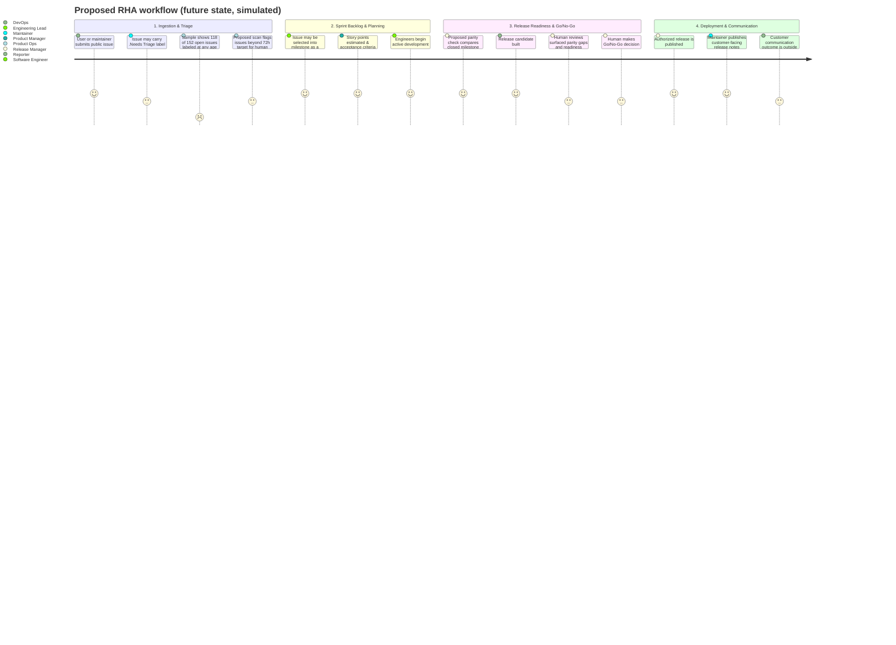

# Current vs. Future State User Journey

This journey uses the public issue sample to describe an observed tracker state, then maps a proposed Release Health Assistant workflow. The sample does not reveal customer churn, assignment state, communications, or the product team's internal process. Future-state steps are hypothetical and not implemented.

---

## 1. Current State (Observed Sample + Evidence Limits)

1. A user or maintainer submits an issue to the public tracker.
2. The sampled tracker contains 152 open issues; 118 (77.6%) carry `.Needs Triage` at any age.
3. The sample does not show whether those issues are assigned, how long they have waited, whether the reporter received an update, or whether any customer churned.
4. Issues may later be associated with milestones and public releases; this dataset does not verify the internal steps used to prepare release notes.

The 77.6% figure is a snapshot label share, not proof that issues are unassigned, stale, or causing customer churn.

## 2. Future State (Proposed RHA Workflow)

1. An open issue carrying `.Needs Triage` remains in the tracker; a proposed daily scan flags it after the proposed 72-hour target.
2. RHA sends a digest for a human to review and route; it does not autonomously assign or change issue priority in this proposal.
3. Before release, a proposed parity check compares closed milestone issues with draft release notes and surfaces mismatches for human resolution.
4. A proposed readiness checklist summarizes blockers, test evidence, parity status, and required sign-offs for a Go/No-Go decision.
5. After an authorized release, maintainers can publish customer-facing release notes; this case study does not implement or verify customer notifications.

## 3. Proposed Multi-Persona Journey Map

---

## 4. Stage Breakdown, Evidence Limits & Opportunities

| Stage | Persona & Goal | What the sample supports | Product opportunity (proposed) |
|---|---|---|---|
| **1. Intake & Triage** | **Product Ops / Maintainers:** Review, classify, and route issues. | 118 of 152 sampled open issues (77.6%) carry `.Needs Triage` at any age. Assignment and issue age beyond creation date are not evaluated here. | Flag issues past a proposed 72-hour target for human review; do not auto-assign or infer priority without approval. |
| **2. Backlog Planning** | **Product / Engineering Lead:** Select and clarify work. | The dataset includes issue types and priorities, but does not measure grooming quality or roadmap-capacity impact. | Use consistent story templates and acceptance criteria; validate usability with a pilot. |
| **3. Release Readiness** | **Release Manager:** Review scope, evidence, and release notes. | The audit does not observe internal note-preparation steps or measure parity gaps. | Compare milestone issue IDs with draft notes and surface possible gaps for human resolution. |
| **4. Customer Communication** | **Release / Support teams:** Publish accurate release information. | The sample does not measure customer notifications, missed fixes, or customer outcomes. | Keep release communication with authorized owners; evaluate a proposed notes draft workflow before adoption. |
