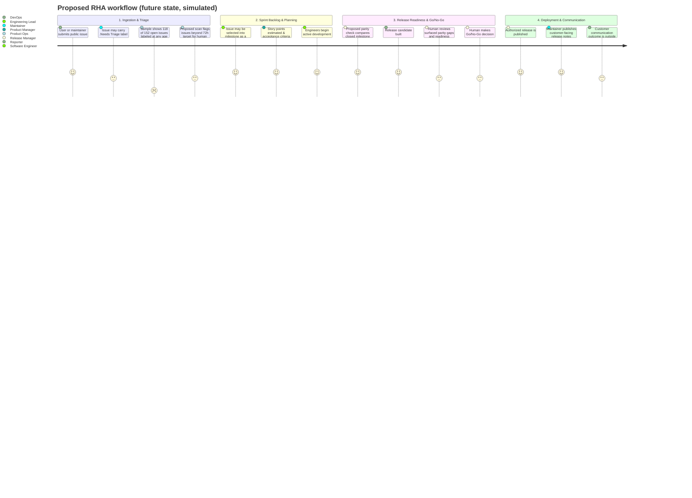
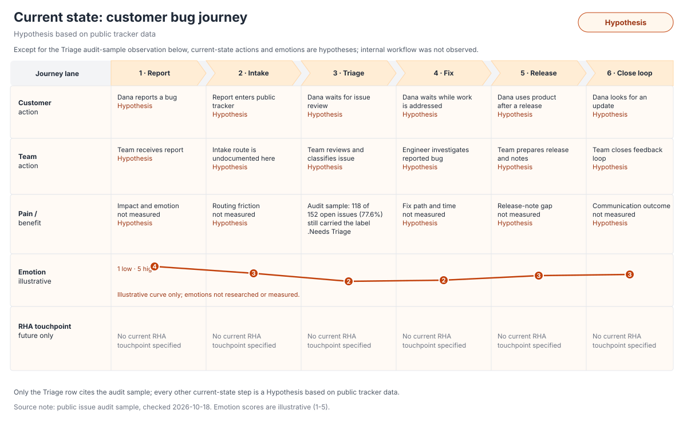
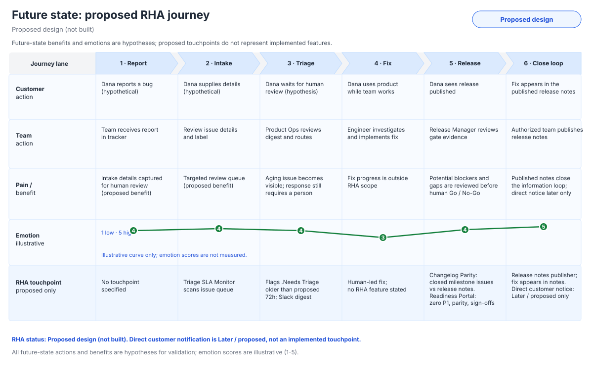

# Current vs. Future State User Journey

**Hypothesis based on public tracker data.** This journey uses a public issue sample and a proposed design; it is not observed customer research. The sample does not reveal customer churn, assignment state, communications, or the product team's internal process. Future-state steps are a **Proposed design (not built)**.

---

## 1. Current State (Observed Sample + Evidence Limits)

1. A user or maintainer submits an issue to the public tracker.
2. The sampled tracker contains 152 open issues; 118 (77.6%) carry `.Needs Triage` at any age.
3. The sample does not show whether those issues are assigned, how long they have waited, whether the reporter received an update, or whether any customer churned.
4. Issues may later be associated with milestones and public releases; this dataset does not verify the internal steps used to prepare release notes.

The 77.6% figure is a snapshot label share, not proof that issues are unassigned, stale, or causing customer churn.

## 2. Future State (Proposed RHA Workflow)

1. An open issue carrying `.Needs Triage` remains in the tracker; a proposed daily scan flags it after the proposed 72-hour target.
2. RHA sends a digest for a human to review and route; it does not autonomously assign or change issue priority in this proposal.
3. Before release, a proposed parity check compares closed milestone issues with draft release notes and surfaces mismatches for human resolution.
4. A proposed readiness checklist summarizes blockers, test evidence, parity status, and required sign-offs for a Go/No-Go decision.
5. After an authorized release, maintainers can publish customer-facing release notes; this case study does not implement or verify customer notifications.

## 3. Proposed Multi-Persona Journey Map

---

## 4. Stage Breakdown, Evidence Limits & Opportunities

| Stage | Persona & Goal | What the sample supports | Product opportunity (proposed) |
|---|---|---|---|
| **1. Intake & Triage** | **Product Ops / Maintainers:** Review, classify, and route issues. | 118 of 152 sampled open issues (77.6%) carry `.Needs Triage` at any age. Assignment and issue age beyond creation date are not evaluated here. | Flag issues past a proposed 72-hour target for human review; do not auto-assign or infer priority without approval. |
| **2. Backlog Planning** | **Product / Engineering Lead:** Select and clarify work. | The dataset includes issue types and priorities, but does not measure grooming quality or roadmap-capacity impact. | Use consistent story templates and acceptance criteria; validate usability with a pilot. |
| **3. Release Readiness** | **Release Manager:** Review scope, evidence, and release notes. | The audit does not observe internal note-preparation steps or measure parity gaps. | Compare milestone issue IDs with draft notes and surface possible gaps for human resolution. |
| **4. Customer Communication** | **Release / Support teams:** Publish accurate release information. | The sample does not measure customer notifications, missed fixes, or customer outcomes. | Keep release communication with authorized owners; evaluate a proposed notes draft workflow before adoption. |

---

## 5. Six-Stage Journey Comparison

**Persona (hypothetical):** Dana, a customer admin reporting a bug. Internal roles are Product Ops Lead, Engineer, and Release Manager. Emotion scores are illustrative (1-5), not measured research.

### Current State: Hypothesis Based on Public Tracker Data

Only the Triage stage below cites the audit-sample statistic. All other current-state actions, team steps, pain points, and emotions are hypotheses.

| Stage | Customer action | Team action | Pain point or benefit | Emotion (illustrative, 1-5) | Opportunity / RHA touchpoint |
|---|---|---|---|---:|---|
| Report | Dana submits a bug report (hypothesis). | A report reaches the public tracker (hypothesis). | Intake experience is not observed (hypothesis). | 4 | No current RHA touchpoint specified. |
| Intake | Dana expects the report to be reviewed (hypothesis). | Intake routing is not verified. | Routing and response time are not measured (hypothesis). | 3 | No current RHA touchpoint specified. |
| Triage | Dana waits for review (hypothesis). | In the audit sample, 118 of 152 open issues (77.6%) still carried the `.Needs Triage` label. | Label presence is observed; age and assignment are not measured. | 2 | Proposed design (not built): Triage SLA Monitor. |
| Fix | Dana waits while work is addressed (hypothesis). | Engineer investigates and fixes the issue (hypothesis). | Fix process and duration are not established by this sample (hypothesis). | 2 | No current RHA touchpoint specified. |
| Release | Dana uses a product version after release (hypothesis). | Release Manager prepares a release (hypothesis). | Release preparation pain is not observed (hypothesis). | 3 | No current RHA touchpoint specified. |
| Close the loop | Dana looks for a resolution update (hypothesis). | Team communicates an outcome (hypothesis). | Communication and customer outcome are not measured (hypothesis). | 3 | No current RHA touchpoint specified. |

### Future State: Proposed Design (Not Built)

| Stage | Customer action | Team action | Pain point or benefit | Emotion (illustrative, 1-5) | Proposed design touchpoint |
|---|---|---|---|---:|---|
| Report | Dana submits a bug report (hypothetical). | Team receives the report in its tracker. | Intake details are available for human review (proposed benefit). | 4 | No RHA feature specified at report creation. |
| Intake | Dana supplies available context (hypothetical). | Product Ops reviews intake fields and labels. | A consistent review queue is a proposed benefit. | 4 | Triage SLA Monitor scans for `.Needs Triage`. |
| Triage | Dana awaits a human response (hypothetical). | Product Ops reviews a Slack digest and routes the issue. | Flags `.Needs Triage` issues older than the proposed 72h target; routing remains human-reviewed. | 4 | Triage SLA Monitor flags; proposed Slack digest. |
| Fix | Dana continues normal product use (hypothetical). | Engineer investigates and implements a fix. | Fix implementation remains outside RHA; no outcome is promised. | 3 | No RHA fix automation specified. |
| Release | Dana sees a release become available (hypothetical). | Release Manager reviews blockers, parity, and sign-offs. | A pre-release review could make gaps visible (hypothesis). | 4 | Changelog Parity Validator compares closed milestone issues vs release notes; Go/No-Go Readiness Portal checks zero P1, parity, and sign-offs. |
| Close the loop | Dana can find the fix in published release notes (proposed workflow). | Authorized team publishes notes using the proposed release notes publisher. | Published notes show the fix; direct customer notification is Later / proposed only. | 5 | Release notes publisher; direct customer notification is Later / proposed. |

The journey diagrams use identical geometry for comparison. Their emotion curves are illustrative only. The only current-state numeric observation is the Triage audit-sample label share.
