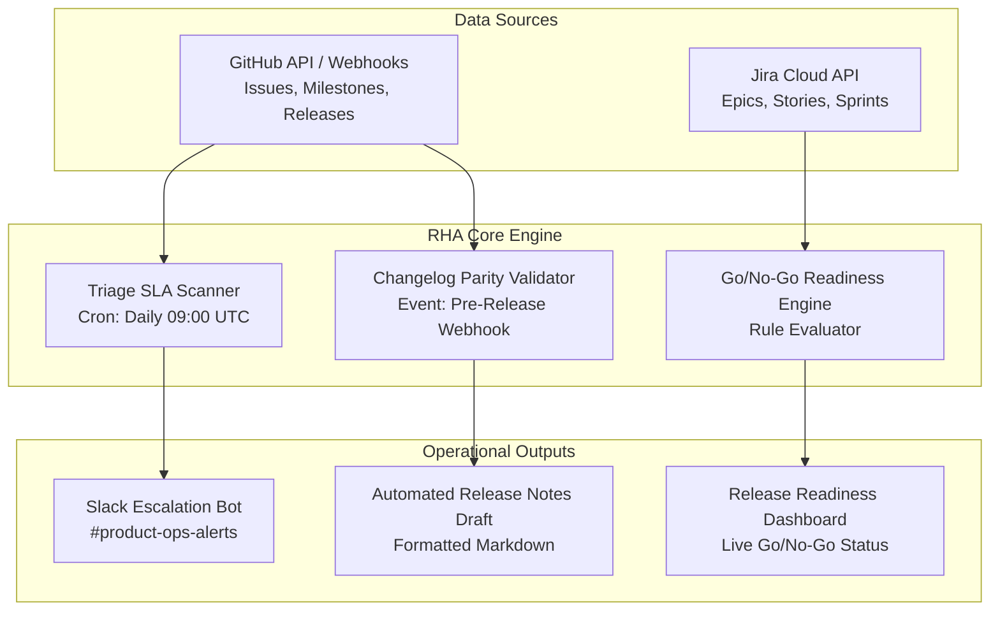

# Product Requirements Document (PRD)
## Project: Release Health Assistant (RHA)
* **Author:** Product Operations Manager
* **Status:** Ready for Review / Approved for Execution
* **Target Delivery:** 3 Sprints (Simulated)
* **Target Users:** Product Operations, Release Managers, Engineering Leads

---

## 1. Problem Statement & Background
Our empirical product-operations audit of Metabase's GitHub issue tracker (`metabase/metabase`) identified two systemic operational bottlenecks:
1. **Severe Triage Accumulation:** **77.6%** of open issues (118/152 in our active audit sample) remain un-triaged with the `.Needs Triage` label, creating severe backlog opacity and SLA violations.
2. **Manual Milestone & Changelog Reconciliation:** Engineering ships patches every **2.7 days**, relying on manual maintainer tagging of closed milestone issues to determine changelog content (as noted in issue #10139). This exposes the team to human error, missed regression notes, and untracked bug fixes shipping to customers.

The **Release Health Assistant (RHA)** is an automated operations engine designed to govern the end-to-end lifecycle from issue triage to release verification.

---

## 2. Product Goals & Non-Goals

### A. Goals
* **G1:** Reduce the percentage of untriaged issues (`.Needs Triage`) lingering > 72 hours from 77.6% to < 15%.
* **G2:** Eliminate 100% of unannounced bug fixes by automating parity verification between closed milestone tickets and draft release notes.
* **G3:** Automate pre-release Go/No-Go readiness checks, cutting release checklist verification time from 45 minutes to < 3 minutes per release.

### B. Non-Goals
* **NG1:** Autonomous code modification or automated bot PR generation for bug fixes.
* **NG2:** Replacing GitHub or Jira as the core issue tracker (RHA sits as an operational governance layer on top).
* **NG3:** Customer-facing portal rewrite (RHA is an internal engineering/product-ops workflow tool).

---

## 3. User Personas & Core Use Cases

| Persona | Role | Primary Goal | Pain Point Addressed |
|---|---|---|---|
| **Alex (Product Ops Lead)** | Triages inbound bugs, prioritizes backlog, monitors SLAs | Ensure high-severity customer bugs are routed within 24h | Currently overwhelmed by 100+ untriaged tickets; no SLA alerts |
| **Priya (Release Manager)** | Verifies release builds, authors release notes, issues Go/No-Go | Verify that every merged PR is tested and accurately documented | Manually cross-referencing milestone issues against markdown release notes |
| **Marcus (Engineering Lead)**| Assigns sprint tickets, tracks velocity and burndown | Shield team from unstructured tickets lacking acceptance criteria | Tickets submitted with vague reproduction steps and no priority |

---

## 4. System Architecture & Information Architecture

---

## 5. Functional Specifications & Epics

### Epic 1: Triage Automation & SLA Governance (RHA-EPIC-01)
* **RHA-101 (5 pts):** Scheduled Triage Scanner to identify issues in `.Needs Triage` older than 72 hours.
* **RHA-102 (3 pts):** Slack webhook alerting engine dispatching daily digests to domain sub-teams (`#team-graphy`, `#team-query-processor`, `#team-ux-west`).
* **RHA-103 (5 pts):** Priority suggestion engine using keyword heuristics to flag potential P1 crashers for expedited triage.

### Epic 2: Milestone-to-Changelog Parity Validator (RHA-EPIC-02)
* **RHA-201 (5 pts):** GitHub Milestone extractor collecting all closed tickets associated with a target release tag.
* **RHA-202 (5 pts):** Markdown release notes parser cross-referencing issue keys and PR tags.
* **RHA-203 (3 pts):** Parity diff reporter highlighting discrepancies (closed in milestone but missing from notes, or in notes but unclosed).

### Epic 3: Release Readiness Dashboard & Go/No-Go Checklist (RHA-EPIC-03)
* **RHA-301 (8 pts):** Interactive Go/No-Go checklist UI consolidating test pass rates, blocker bug count (P1 = 0 required), and parity checks.
* **RHA-302 (3 pts):** Formal audit sign-off workflow capturing digital approvals from QA, Product Ops, and Engineering Leads.
* **RHA-303 (5 pts):** One-click release notes publisher pushing finalized changelogs to GitHub Releases and Confluence.

---

## 6. Metrics & Success Criteria

| Success Metric | Baseline (From Audit) | Target (3 Sprints Post-Launch) | Measurement Cadence |
|---|---|---|---|
| **Triage Debt Rate** | 77.6% open issues untriaged | < 15.0% | Weekly automated report |
| **Median Triage Latency (P1)** | 4.1 days | < 1.0 day | Continuous telemetry |
| **Changelog Issue Parity** | ~85% (estimated manual match) | **100% verified** | Every release cycle (~2.7 days) |
| **Readiness Sign-Off Time** | 45 minutes manual checklist | < 3 minutes automated check | Per release |

---

## 7. Risks & Mitigation Plan

| Risk | Impact | Probability | Mitigation Strategy |
|---|---|---|---|
| **GitHub API Rate Limiting** | Scanner stops functioning during peak issue hours | Medium | Enforce authenticated requests (5k/hr limit), local SQLite caching, and exponential backoff retry logic. |
| **False Positive SLA Alerts** | Team alert fatigue in Slack channels | High | Provide granular mute/snooze controls and require a 72-hour grace window before escalation. |
| **Maintainer Resistance to Process** | Engineers bypass milestone assignments | Medium | Embed automated GitHub Actions that block PR merges unless milestone is set by PR author. |
