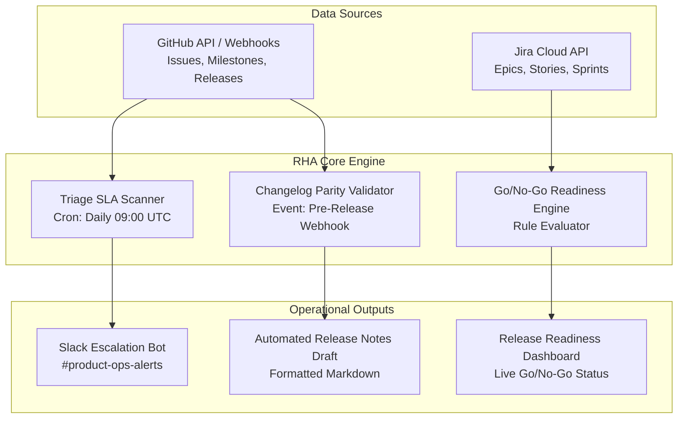

# Product Requirements Document (PRD)
## Project: Release Health Assistant (RHA)
* **Author:** Subham Tripathy
* **Status:** Draft v1 (portfolio case study)
* **Target Delivery:** 3 Sprints (Simulated)
* **Target Users:** Product Operations, Release Managers, Engineering Leads

## Version History

| Version | Date | Change |
|---|---|---|
| v0.1 | 2026-10-18 | Initial draft for portfolio case study |
| v1.0 | TBD | Planned baseline, requirements, and acceptance criteria review |

## Stakeholders (RACI)

| Role | Responsibility |
|---|---|
| Product Ops | Accountable (A) |
| Engineering Lead | Responsible (R) |
| Release Manager | Responsible (R) |
| QA | Consulted (C) |
| Support | Informed (I) |

---

## 1. Problem Statement & Background
Our audit of a sample of Metabase's public issue tracker found that 77.6% of open issues (118 of 152) carried the `.Needs Triage` label. We hypothesize that manual reconciliation between closed milestone issues and release notes could cause omissions. This is a hypothesis; the audit does not observe Metabase's internal process. We use 72 hours as a proposed triage target, not an existing Metabase SLA.

The **Release Health Assistant (RHA)** is an automated operations engine designed to govern the end-to-end lifecycle from issue triage to release verification.

---

## 2. Product Goals & Non-Goals

### A. Goals
* **G1:** Reduce the share of open issues carrying `.Needs Triage` for more than 72 hours from an unmeasured baseline to <15% (target; assumption).
* **G2:** Detect release-note parity gaps between closed milestone issues and draft release notes; 100% verification is a target (assumption), not a measured result.
* **G3:** Automate pre-release Go/No-Go readiness checks; reduce checklist verification time from an unmeasured baseline to <3 minutes per release (target; assumption).

### B. Non-Goals
* **NG1:** Autonomous code modification or automated bot PR generation for bug fixes.
* **NG2:** Replacing GitHub or Jira as the core issue tracker (RHA sits as an operational governance layer on top).
* **NG3:** Customer-facing portal rewrite (RHA is a proposed internal engineering/product-ops workflow tool).

---

## 3. User Personas & Core Use Cases

Personas are hypothetical.

| Persona | Role | Primary Goal | Pain Point Addressed |
|---|---|---|---|
| **Alex (Product Ops Lead)** | Triages inbound bugs, prioritizes backlog, monitors SLAs | Ensure high-severity customer bugs are routed within 24h | Currently overwhelmed by 100+ untriaged tickets; no SLA alerts |
| **Priya (Release Manager)** | Verifies release builds, authors release notes, issues Go/No-Go | Verify that every merged PR is tested and accurately documented | Manually cross-referencing milestone issues against markdown release notes |
| **Marcus (Engineering Lead)**| Assigns sprint tickets, tracks velocity and burndown | Shield team from unstructured tickets lacking acceptance criteria | Tickets submitted with vague reproduction steps and no priority |

---

## 4. System Architecture & Information Architecture

---

## 5. Functional Specifications & Epics

### Epic 1: Triage Automation & SLA Governance (RHA-EPIC-01)
* **RHA-101 (5 pts):** Scheduled Triage Scanner to identify issues in `.Needs Triage` older than 72 hours.
* **RHA-102 (3 pts):** Slack webhook alerting engine dispatching daily digests to domain sub-teams (`#team-graphy`, `#team-query-processor`, `#team-ux-west`).
* **RHA-103 (5 pts):** Priority suggestion engine using keyword heuristics to flag potential P1 crashers for expedited triage.
* **RHA-104 (3 pts):** Triage target monitoring telemetry and metrics emitter.
* **RHA-105 (3 pts):** Spike to assess GitHub Search API rate limits and caching strategy.
* **Epic total:** 19 points (matches `backlog.csv`).

### Epic 2: Milestone-to-Changelog Parity Validator (RHA-EPIC-02)
* **RHA-201 (5 pts):** GitHub Milestone extractor collecting all closed tickets associated with a target release tag.
* **RHA-202 (5 pts):** Markdown release notes parser cross-referencing issue keys and PR tags.
* **RHA-203 (3 pts, Fix):** Parity diff reporter highlighting discrepancies (closed in milestone but missing from notes, or in notes but unclosed).
* **RHA-204 (5 pts):** GitHub pull request status check integration.
* **RHA-205 (3 pts):** Automated release draft generator from milestone tickets.
* **Epic total:** 21 points (matches `backlog.csv`).

### Epic 3: Release Readiness Dashboard & Go/No-Go Checklist (RHA-EPIC-03)
* **RHA-301 (8 pts):** Interactive Go/No-Go checklist UI consolidating test pass rates, blocker bug count (P1 = 0 required), and parity checks.
* **RHA-302 (3 pts):** Formal audit sign-off workflow capturing digital approvals from QA, Product Ops, and Engineering Leads.
* **RHA-303 (5 pts):** One-click release notes publisher pushing finalized changelogs to GitHub Releases and Confluence.
* **RHA-304 (3 pts):** Pilot onboarding telemetry and feedback collector.
* **RHA-305 (3 pts):** End-to-end integration test suite and load benchmark (planned; not implemented or executed).
* **Epic total:** 22 points (matches `backlog.csv`).

**Total backlog scope: 62 story points**, matching `04-requirements/backlog.csv`. The sprint descriptions and release artifacts remain simulated, not evidence of completed implementation.

### User Stories & Acceptance Criteria

#### RHA-101 (Must, 5 pts)
As a Product Ops Lead, I want a daily scan for `.Needs Triage` issues older than 72 hours, so that untriaged work is flagged before it goes stale.

* **Given** an issue is open for more than 72 hours and carries `.Needs Triage`, **when** the daily scan runs at 09:00 UTC, **then** it is marked “Breaching target” and included in the team's Slack digest.
* **Given** the `.Needs Triage` label is removed within 72 hours, **then** the issue is excluded from the digest.

#### RHA-201 (Must, 5 pts)
As a Release Manager, I want the release's closed milestone issues collected, so that I can compare the release scope with draft notes.

* **Given** a release milestone is selected, **when** the extractor runs, **then** it returns the associated closed issues with issue IDs and states.
* **Given** an issue was transferred or reopened, **then** its current repository and state are preserved for parity review.

#### RHA-301 (Must, 8 pts)
As a Release Manager, I want a readiness view of blockers, test evidence, and parity status, so that release decisions use a consistent checklist.

* **Given** the readiness gate is evaluated, **when** any required check is missing or a P1 blocker remains open, **then** the gate reports “No-Go” and identifies the failed checks.
* **Given** all configured checks pass, **then** the gate reports “Go” and records the evaluation result and timestamp; this is a target workflow, not an implemented feature.

### Prioritization (MoSCoW)

| Priority | Stories | Rationale |
|---|---|---|
| Must | RHA-101, RHA-102, RHA-201, RHA-202, RHA-203, RHA-301 | Core loop: detect, notify, reconcile, and gate |
| Should | RHA-104, RHA-105, RHA-204, RHA-205, RHA-302, RHA-303, RHA-304, RHA-305 | Telemetry, API/cache discovery, status checks, draft generation, audit trail, publishing, pilot feedback, and proposed test coverage support the core loop |
| Could | RHA-103 | Keyword-based P1 suggestion; accuracy is uncertain |

### Non-Functional Requirements

* Use authenticated GitHub API requests where configured and respect published rate limits; backoff thresholds are implementation targets, not measured results.
* Provide alert mute and snooze controls to reduce notification fatigue.
* Record an audit log for readiness evaluations and sign-offs.
* Minimize retained data; do not store issue text in the proposed RHA service.
* Numeric performance and availability goals remain assumptions until measured in an implemented pilot.

### Assumptions & Dependencies

* A GitHub token, Slack webhook, and Jira Cloud API access are available to the deployment.
* `.Team/*` labels can be mapped to Slack channels; the mapping requires owner confirmation.
* Release milestones are usable proxies for release scope, not equivalent to formal sprints.

### Edge Cases

* Issues transferred between repositories.
* Issues reopened after milestone closure.
* Issues closed without a milestone.
* Releases cut from maintenance branches.

### Tracking Plan

| Event | Required properties |
|---|---|
| `triage_scan_completed` | timestamp, result |
| `sla_breach_flagged` | timestamp, issue ID, result |
| `parity_check_run` | timestamp, release ID, result |
| `parity_gap_found` | timestamp, release ID, issue ID, result |
| `readiness_gate_evaluated` | timestamp, release ID, result |
| `signoff_recorded` | timestamp, release ID, result |

Tracking is proposed only; no product telemetry is currently collected.

---

## 6. Metrics & Success Criteria

| Success Metric | Baseline (From Audit) | Target (3 Sprints Post-Launch) | Measurement Cadence |
|---|---|---|---|
| **Open issues with `.Needs Triage` (any age)** | 77.6% (118/152 open issues in sample) | <15% carrying the label >72h (assumption) | Recompute with dated snapshot |
| **Median time to first priority label (P1)** | Not yet measured (needs issue-event data) | <1 day (assumption) | Requires issue timeline events |
| **Changelog Issue Parity** | Not measured (assumption: ~85%) | 100% verified (assumption) | Each release cycle |
| **Readiness Sign-Off Time** | Assumption: ~45 min (not measured) | <3 min (assumption) | Per release |

Baselines marked “assumption” are illustrative and would be measured in a real pilot.

---

## 7. Risks & Mitigation Plan

| Risk | Impact | Probability | Mitigation Strategy |
|---|---|---|---|
| **GitHub API Rate Limiting** | Scanner stops functioning during peak issue hours | Medium | Enforce authenticated requests (5k/hr limit), local SQLite caching, and exponential backoff retry logic. |
| **False Positive SLA Alerts** | Team alert fatigue in Slack channels | High | Provide granular mute/snooze controls and require a 72-hour grace window before escalation. |
| **Maintainer Resistance to Process** | Engineers bypass milestone assignments | Medium | Embed automated GitHub Actions that block PR merges unless milestone is set by PR author. |

### Rollout Plan (Proposed)

| Phase | Exit criteria (targets, not results) |
|---|---|
| Internal alpha | Core scan, parity, and gate workflows reviewed by internal users; no unresolved critical defects in the test plan |
| Pilot | Opt-in team completes a pilot; target alert usefulness and parity review criteria are agreed before measurement |
| GA | Security, reliability, documentation, and ownership gates are met; criteria must be measured before launch |

### Open Questions

* Should the proposed 72-hour triage target vary by team or priority?
* Who owns and reviews the alert mute list?
* How are parity mismatches assigned and resolved?

### Glossary

* **Triage:** Initial classification and routing of an issue.
* **Parity:** Agreement between the release's issue set and its release notes.
* **Gate:** A set of checks used to inform a Go/No-Go decision.
* **SLA vs. target:** An SLA is a committed service-level agreement; the 72-hour value here is only a proposed target.
