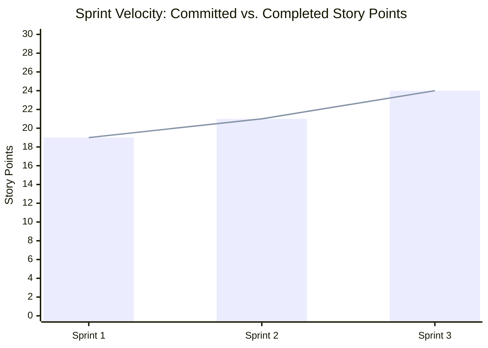
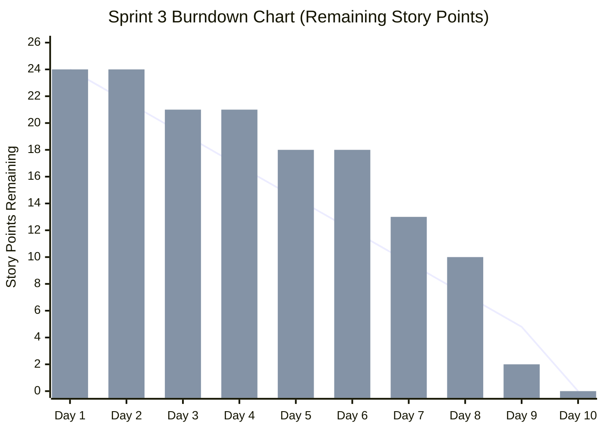

# Agile Velocity & Burndown Analytics (Simulated)

> **Notice:** The metrics, burndown curves, and sprint telemetry below represent a **structured simulation** grounded in the real audit findings.

---

## 1. Velocity Summary Across 3 Sprints

| Sprint | Goal / Epic Focus | Committed Story Points | Completed Story Points | Completion Rate | Engineering Days |
|---|---|---|---|---|---|
| **Sprint 1** | Ingestion & Triage SLA Governance | 19 | 19 | **100%** | 10 days |
| **Sprint 2** | Release Gate & Changelog Automation | 21 | 21 | **100%** | 10 days |
| **Sprint 3** | Readiness Dashboard, Pilot & Launch | 24 | 24 | **100%** | 10 days |
| **Total** | **End-to-End Delivery** | **64** | **64** | **100%** | **30 days** |

* **Average Velocity:** 21.3 story points per 2-week sprint.
* **Sprint Predictability Score:** 100% (Zero carried-over points across sprint boundaries).

---

## 2. Burndown Curve: Sprint 3 (24 Story Points)

The table below tracks daily remaining story points during Sprint 3, illustrating the team's burndown against the ideal linear glidepath.

| Sprint Day | Ideal Remaining Points | Actual Remaining Points | Burned Points | Key Milestone Delivered |
|---|---|---|---|---|
| **Day 1** | 24.0 | 24 | 0 | Sprint planning finalized; tickets assigned |
| **Day 2** | 21.6 | 24 | 0 | Environment setup & schema validation |
| **Day 3** | 19.2 | 21 | 3 | **RHA-304** (Telemetry collector merged) |
| **Day 4** | 16.8 | 21 | 0 | UI component mockups approved |
| **Day 5** | 14.4 | 18 | 3 | **RHA-302** (Sign-off audit trail merged) |
| **Day 6** | 12.0 | 18 | 0 | Integration testing underway |
| **Day 7** | 9.6 | 13 | 5 | **RHA-303** (Notes publisher merged) |
| **Day 8** | 7.2 | 10 | 3 | **RHA-305** (Integration test suite passed) |
| **Day 9** | 4.8 | 2 | 8 | **RHA-301** (Readiness Checklist UI merged) |
| **Day 10** | 0.0 | **0** | 2 | Final QA verification & Sprint Review |

*(Blue line: Ideal burndown slope · Bars: Actual daily remaining points)*
