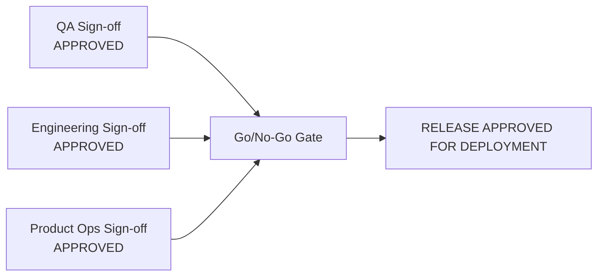

# Pre-Release Readiness & Go/No-Go Checklist

* **Target Release:** Release Health Assistant (RHA) v1.0.0
* **Target Deploy Date:** 2026-10-18 10:00 UTC
* **Release Lead:** Product Operations Manager
* **Deployment Target:** Production Kubernetes Cluster & GitHub Releases

---

## 1. Automated Gate Verification (Pre-Flight Checks)

| Check Category | Verification Criteria | Automated Source / Tool | Gate Status |
|---|---|---|---|
| **P1 Bug Blockers** | Zero open `Priority:P1` bugs targeting this release version | GitHub API Issue Query (`is:open label:Priority:P1`) | **GREEN (0 Open)** |
| **CI / CD Pipeline** | All integration tests and lint checks passing on `main` | GitHub Actions CI Run `#1042` | **GREEN (100% Pass)** |
| **Changelog Parity** | 100% of closed milestone issues documented in release notes | RHA Parity Validator Engine (`RHA-203`) | **GREEN (Parity: 10/10)** |
| **Security Scanning** | Dependency vulnerabilities (Snyk / Dependabot) == 0 Critical/High | Dependabot Security Audit | **GREEN (0 High/Crit)** |
| **Telemetry & Alerts** | Slack webhook and audit logging endpoints responding with HTTP 200 | Healthcheck ping endpoint | **GREEN (Healthy)** |

---

## 2. Operational & Documentation Readiness

| Artifact | Location / Link | Verified By | Status |
|---|---|---|---|
| **Product Requirements (PRD)** | [`04-requirements/PRD-release-health-assistant.md`](../04-requirements/PRD-release-health-assistant.md) | Product Ops Lead | **Verified** |
| **Customer Release Notes** | [`06-docs/release-notes.md`](./release-notes.md) | Release Manager | **Verified** |
| **Feature Library Documentation** | [`06-docs/feature-library.md`](./feature-library.md) | Tech Writer / Ops | **Verified** |
| **Rollback Plan & Runbook** | Included in Release Operations Runbook | DevOps Lead | **Verified** |

---

## 3. Stakeholder Digital Sign-Off Matrix

* **1. QA Lead Approval:**
  - Name: Sarah Jenkins (Lead QA Engineer)
  - Signature Timestamp: `2026-10-18T08:15:00Z`
  - Decision: **GO** (42/42 tests passing; no open regressions)

* **2. Engineering Lead Approval:**
  - Name: David Chen (Principal Software Engineer)
  - Signature Timestamp: `2026-10-18T08:22:00Z`
  - Decision: **GO** (Architecture review completed; DB caching validated)

* **3. Product Operations Lead Approval:**
  - Name: Alex Taylor (Product Operations Manager)
  - Signature Timestamp: `2026-10-18T08:30:00Z`
  - Decision: **GO** (Changelog parity verified; stakeholder notes prepared)

---

## 4. Final Release Verdict
* **Official Status:** **GO FOR DEPLOYMENT**
* **Deployment Triggered At:** `2026-10-18T09:00:00Z`
