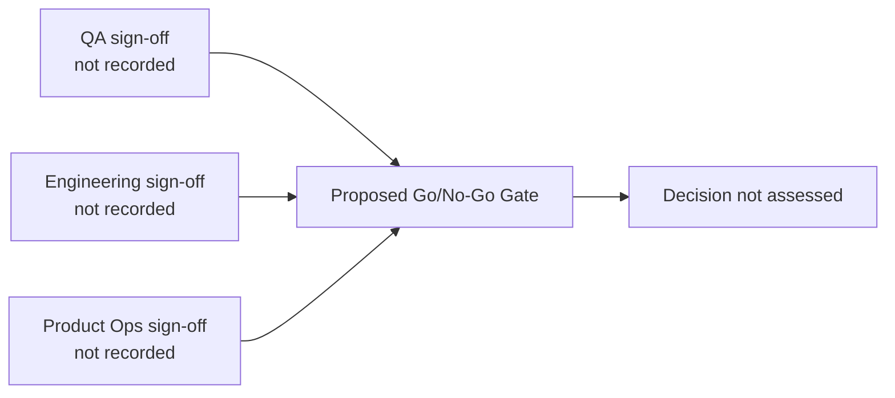

# Pre-Release Readiness Checklist (simulated)

> Simulated readiness checklist for a portfolio case study. No production system, CI pipeline, security scan, or deployment was verified.

* **Target Release:** Proposed Release Health Assistant (RHA) v1.0.0
* **Target Deploy Date:** Not scheduled
* **Release Lead:** Not assigned
* **Deployment Target:** Not deployed

---

## 1. Automated Gate Verification (Pre-Flight Checks)

| Check Category | Verification Criteria | Automated Source / Tool | Gate Status |
|---|---|---|---|
| **P1 Bug Blockers** | Review open P1 issues against the proposed release scope | Planned GitHub issue query | **Not run** |
| **CI / CD Pipeline** | Run tests and lint checks on the release candidate | CI workflow not configured | **Not run** |
| **Changelog Parity** | Compare closed milestone issues with draft release notes | Proposed RHA-203 workflow | **Not run** |
| **Security Scanning** | Scan dependencies for critical/high vulnerabilities | Tool not configured | **Not run** |
| **Telemetry & Alerts** | Verify Slack webhook and audit logging responses | Integrations not configured | **Not run** |

---

## 2. Operational & Documentation Readiness

| Artifact | Location / Link | Verified By | Status |
|---|---|---|---|
| **Product Requirements (PRD)** | [`04-requirements/PRD-release-health-assistant.md`](../04-requirements/PRD-release-health-assistant.md) | Not assigned | **Draft** |
| **Customer Release Notes** | [`06-docs/release-notes.md`](./release-notes.md) | Not assigned | **Simulated draft** |
| **Feature Library Documentation** | [`06-docs/feature-library.md`](./feature-library.md) | Not assigned | **Not reviewed** |
| **Rollback Plan & Runbook** | Not supplied | Not assigned | **Not available** |

---

## 3. Stakeholder Digital Sign-Off Matrix

No stakeholder approvals or signatures are claimed. Names, timestamps, test results, and deployment records require real verification.

---

## 4. Final Release Verdict
* **Status:** Not assessed; deployment is not authorized or claimed.
