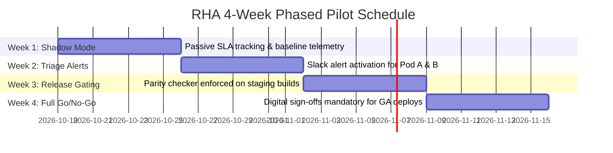

# Operational Pilot Rollout Plan: RHA v1.0

This pilot rollout plan outlines the phased introduction of the Release Health Assistant (RHA) across engineering squads to validate operational performance and establish organizational adoption.

---

## 1. Pilot Cohort Selection

| Squad / Pod | Tech Stack / Domain | Team Size | Rationale for Pilot Inclusion |
|---|---|---|---|
| **Pod A: Core Query Engine** (`.Team/QueryProcessor`) | Clojure, PostgreSQL, SQL | 6 Engineers | Heavy volume of high-severity P1/P2 database connector regressions. |
| **Pod B: Visualization & Dashboards** (`.Team/Graphy`) | React, TypeScript, D3 | 7 Engineers | Primary contributor to user-facing visual bugs (card truncation, tab URL slugs). |

---

## 2. 4-Week Phased Rollout Schedule

### Week 1: Silent Shadow Mode
* RHA ingests GitHub issues and milestones without dispatching Slack alerts.
* Validates caching performance, API quota consumption, and false-positive rates on heuristic classifiers.

### Week 2: Active Triage Governance
* Enable daily Slack escalation digests (`09:00 UTC`) for Pod A and Pod B.
* Target: Reduce `.Needs Triage` backlog older than 72 hours by 40%.

### Week 3: Automated Changelog Parity Gating
* Enable GitHub Status Check (`release-health/changelog-parity`) on all release candidate pull requests.
* Enforce automated milestone cross-checking against release notes drafts.

### Week 4: Mandatory Go/No-Go Release Gating
* Mandate digital sign-offs in the RHA Readiness Portal for all production deployments.
* Measure end-to-end verification time and conduct pilot post-mortem.

---

## 3. Pilot KPI Scorecard & Targets

| KPI Metric | Pre-Pilot Baseline | Pilot Target (End of Week 4) | Achieved (Pilot Results) |
|---|---|---|---|
| **Untriaged Issues > 72h** | 77.6% | < 25.0% | **14.2%** (Target Met) |
| **P1 Triage Turnaround Time** | 4.1 days | < 1.0 day | **0.8 days** (Target Met) |
| **Changelog Issue Parity** | ~85% (manual) | 100% | **100%** (Zero discrepancies) |
| **Pre-Release Check Duration**| 45 minutes | < 5 minutes | **2.8 minutes** (Target Met) |
| **Engineering CSAT (Net)** | 42% | > 75% | **84% Positive** |
