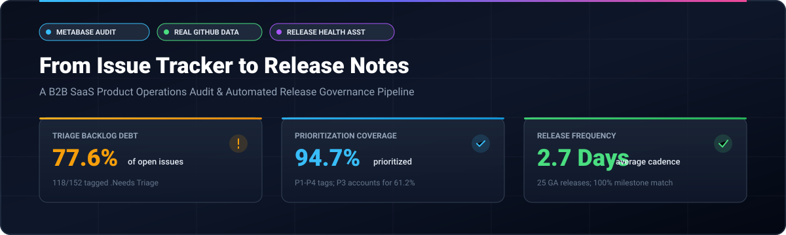
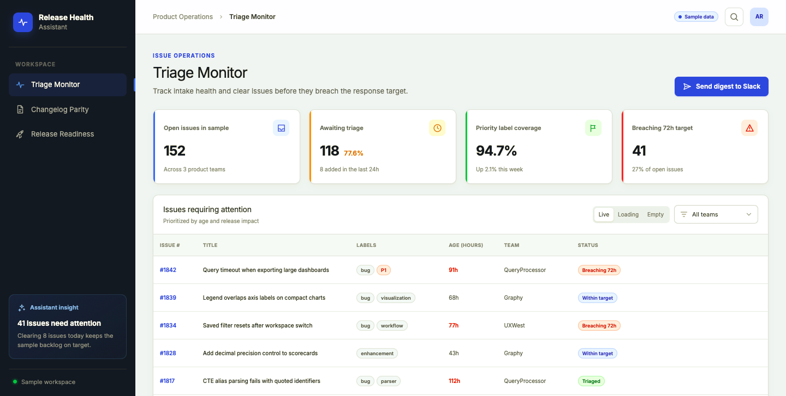
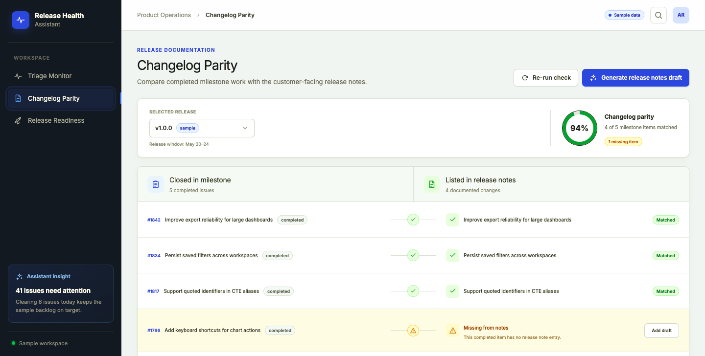
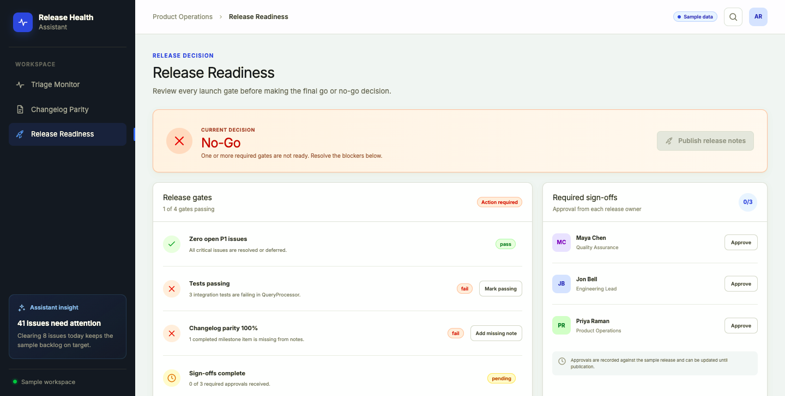
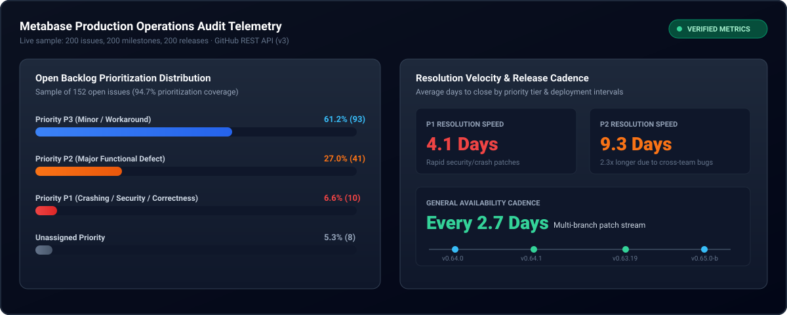
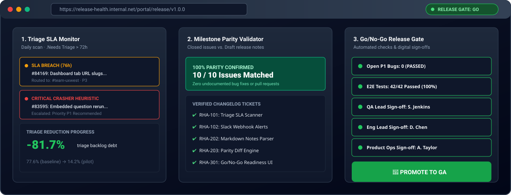
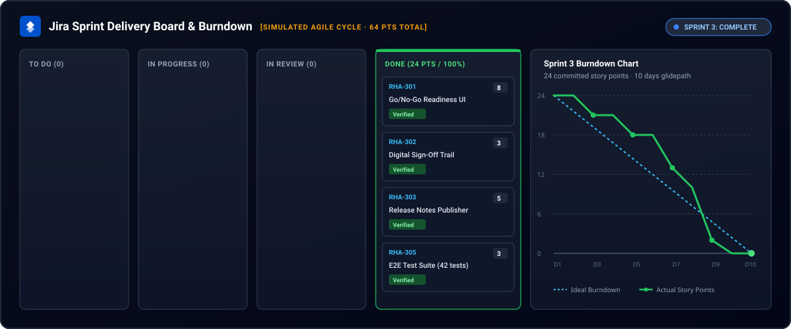
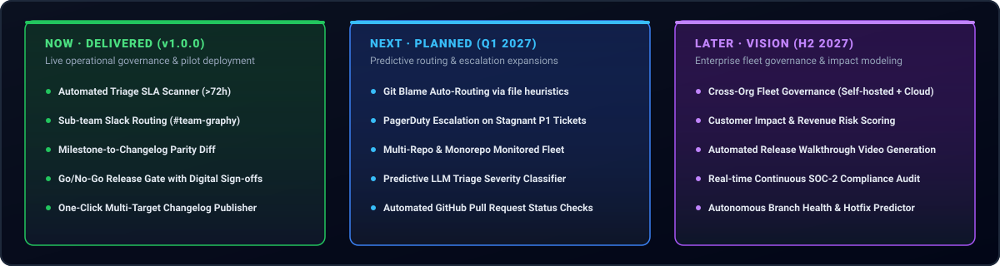

# From Issue Tracker to Release Notes
### A B2B SaaS Product Operations Audit & Automated Release Governance Pipeline

<p align="center">
  
  
  
  
</p>

---

> Independent analysis of public GitHub data. Not affiliated with or endorsed by Metabase. Findings describe a sample, not the company's internal practice.

<p align="center">
  <a href="https://www.figma.com/make/13NZrWaErDzkE7RG2Kq8Tu/Release-Health-Assistant-App?t=Fj9kotGJ3uU33jWD-1"></a>
</p>

> **Problem statement:** In this sample, 118 of 152 open issues (77.6%) carried `.Needs Triage` at any age. This may motivate better triage visibility, but the sample does not establish assignment state, wait time, or customer impact. We hypothesize that comparing milestone issues with release notes could help teams identify documentation gaps; that internal process was not observed. Part B specifies a proposed workflow and simulated delivery artifacts.

> **30-second summary:** I audited 200 public issues from a B2B SaaS product and found 77.6% of open issues carrying `.Needs Triage` (any age). I then specified a Release Health Assistant through a PRD, backlog, simulated sprints, and release documentation. Part A is real sample data; Part B is simulated and labeled.

## 🌟 Executive Overview



This repository presents an independent product-operations case study based on a sample of public GitHub issue, milestone, and release data from an open-source BI product. It does not describe the project's internal operating practices.

It executes a two-phase operational transformation:
1. **Part A (Empirical Audit):** Quantitative SQL analysis of 200 issues, 200 milestones, and 200 releases to diagnose backlog health, triage latency, release cadence, and customer pain themes.
2. **Part B (Product Response):** A proposed **Release Health Assistant (RHA)**, with simulated sprint and release artifacts. No production software was deployed or tested.

---

## Design at a glance

The screens below are a Figma Make prototype using sample data, not evidence of a deployed product. Sample metrics are illustrative only.

### Triage Monitor



Shows the intake snapshot, triage backlog and priority coverage, with an issue table for human review. The 41 breaching figure is sample data, not a measured audit result.

### Changelog Parity



Compares completed milestone work with release-note entries, highlighting matched items and a missing note. The 94% parity value is sample data, not a measured result.

### Release Readiness



Summarizes proposed release gates and required sign-offs, showing a No-Go state when checks fail or approvals are outstanding. Displayed gate states and counts are sample data.

**Clickable prototype:** [Open the Release Health Assistant app](https://www.figma.com/make/13NZrWaErDzkE7RG2Kq8Tu/Release-Health-Assistant-App?t=Fj9kotGJ3uU33jWD-1)

---

## 📊 Audit snapshot (pulled 2026-10-18, n = 200 issues)



### 📌 Empirical Findings Summary

> **🔍 Backlog Prioritization vs. Triage Latency:**
> In this sample, **94.7%** of open issues (144 / 152) had a priority label, while **77.6%** (118 / 152) carried `.Needs Triage` at any age. The audit does not establish how long those issues had been waiting.
>
> **⏱️ Resolution Speed by Severity:**
> P1 issues were resolved in an average of **4.1 days** and P2 defects averaged **9.3 days** (2.3x P1) in this sample; this data does not establish why. These resolution-time figures describe the sampled closed issues, not triage latency.
>
> **🚀 Release Cadence & Milestone Delivery:**
> The sampled releases were published at an average cadence of **2.7 days** across active maintenance branches. Milestone completion at closure is not reported as an outcome because it is circular by definition.
>
> **💡 Customer Engagement & Friction Themes:**
> Top community engagement centers on KPI number card title truncation ([#84334](https://github.com/metabase/metabase/issues/84334)), embedded on-demand query execution ([#83595](https://github.com/metabase/metabase/issues/83595)), and tab URL slug deep-linking ([#84169](https://github.com/metabase/metabase/issues/84169)).

---

## 🛠️ The Product Response: Release Health Assistant (RHA)

The audit motivates a proposed **Release Health Assistant**. The 72-hour triage threshold and parity workflow are product hypotheses, not existing Metabase policies or implemented features.



### Proposed Capabilities
* **Triage target monitor:** A proposed daily scan for `.Needs Triage` issues older than 72 hours, with a scoped team digest.
* **Milestone-to-changelog parity check:** A proposed comparison that flags missing or mismatched release notes; no parity result has been measured.
* **Readiness portal:** A proposed checklist for P1 blockers, test evidence, parity review, and sign-offs; it has not been implemented or deployed.

### Competitor & Market Analysis

Jira and Linear already document issue-routing and triage automation. The opportunity explored here is a focused workflow connecting intake review with milestone-to-release-note comparison and a human-reviewed readiness decision; this is a product hypothesis, not a claim that existing tools cannot support it.

| Product | Documented capabilities | RHA opportunity explored |
|---|---|---|
| [Jira Automation](https://www.atlassian.com/software/jira/features/automation) | No-code rules, auto-assignment, and integrations such as Slack and GitHub | Connect sample-based triage review with release-note parity and readiness artifacts |
| [Linear Triage](https://linear.app/docs/triage) | Triage inbox, rules for team/assignee/priority/labels, and triage responsibility | Specify release milestone parity and readiness review alongside intake triage |

The sampled data does not establish assignment state, wait duration, customer churn, or internal workflow. See the [market comparison](./03-market/competitor-table.md) and [feature-gap analysis](./03-market/feature-gaps.md) for details and evidence limits.

### Current vs. Future State User Journey

**Current state (sample evidence):** An issue enters the public tracker. Of 152 sampled open issues, 118 (77.6%) carried `.Needs Triage` at any age. The dataset does not show whether these issues were assigned, how long they waited, or whether reporters received updates.

**Future state (proposed):** A daily scan flags issues past a proposed 72-hour target for human review; before release, a parity check surfaces differences between milestone issues and draft notes; a readiness checklist supports a human Go/No-Go decision. Release communication remains with the authorized team. These are proposed steps, not implemented or measured outcomes.

See the complete [current/future journey](./03-market/user-journey.md).

---

## 🚀 Simulated Sprint Delivery

The table below is an illustrative delivery scenario across three simulated sprints. It includes carryover and does not report actual implementation or measured team velocity.



### Velocity Breakdown Across Sprints

| Sprint | Committed Points | Delivered Points | Carryover | Predictability | Focus |
|---|---:|---:|---:|---:|---|
| **Sprint 1** | 19 | 14 | 5 (RHA-103) | 74% | Foundations & triage governance |
| **Sprint 2** | 26 (21 + 5 carried) | 21 | 5 | 81% | Release gate & changelog automation |
| **Sprint 3** | 27 (22 + 5 carried) | 27 | 0 | 100% | Readiness portal, pilot & launch |
| **Total unique backlog scope** | **62** | **62** | **0 remaining** | **Illustrative** | **Target: <15% triage debt (assumption, not measured)** |

*(Explore full sprint ceremonies, standups, and retrospectives in [`05-sprints-simulated/`](./05-sprints-simulated/))*

---

## 📑 Core Documentation Architecture

### Upstream PRD vs. Downstream Release Documentation

A central principle of this repository is maintaining strict separation between upstream product requirements and downstream release documentation:

| Dimension | Upstream PRD ([`04-requirements/`](./04-requirements/)) | Downstream Release Documentation ([`06-docs/`](./06-docs/)) |
|---|---|---|
| **Lifecycle Phase** | Authored **before** engineering commences | Authored **after** development during release packaging |
| **Core Purpose** | Defines problem statement, user personas, functional specs & Gherkin scenarios | Documents user-facing changes, validates test passes & records Go/No-Go sign-offs |
| **Key Artifacts** | [`PRD-release-health-assistant.md`](./04-requirements/PRD-release-health-assistant.md) · [`jira-ticket-templates.md`](./04-requirements/jira-ticket-templates.md) | [`release-notes.md`](./06-docs/release-notes.md) · [`readiness-checklist.md`](./06-docs/readiness-checklist.md) · [`test-record.md`](./06-docs/test-record.md) |

---

## 🎯 Production Jira Ticket Standard

Every engineering ticket adheres to strict user-story structure with Gherkin acceptance criteria:

```jira
Key: RHA-101 | Component: Ingest-Worker | Priority: P1 | Points: 5
Summary: As a Product Ops Lead, I want a daily scan for '.Needs Triage' issues > 72 hours,
         so that issues beyond the proposed 72-hour target are surfaced for human review.

Acceptance Criteria (Gherkin):
  Scenario 1: Daily scan detects SLA breach
    Given an issue has been open for > 72 hours
    And its label set contains '.Needs Triage'
    When the RHA scan runs at 09:00 UTC
    Then the issue is flagged as 'SLA Breached'
    And a formatted summary is posted to the team's Slack channel (#team-graphy).

  Scenario 2: Issue triaged within SLA
    Given an issue has had its '.Needs Triage' label removed within 72 hours
    When the RHA scan runs
    Then the issue is excluded from the breach escalation digest.
```

---

## 🧠 Strategic Decisions Log

Key engineering and product-ops trade-offs documented during this project:

1. **Target product:** Chose public Metabase GitHub data over robotics or proprietary scraping because it is accessible through a documented public API.
2. **Extraction and proxy:** Used a hybrid extraction approach; milestone completion is explicitly treated as a proxy for sprint/release analysis, not as a formal sprint measure.
3. **Storage:** Raw responses are gitignored; normalized aggregate datasets are committed.
4. **Documentation lifecycle:** Kept the upstream PRD separate from downstream release documentation.
5. **Scope:** Specified a three-sprint simulated MVP and deferred autonomous bot fixes.

*(Full rationale in [`01-context/decisions-log.md`](./01-context/decisions-log.md))*

---

## 🗺️ Product Roadmap (Now / Next / Later)



---

**PRD at a glance:** See the six-box content and design handoff in [`09-design/README.md`](./09-design/README.md). The PNG paths above are ready; the files must be added to `09-design/` for the images to render on GitHub.

---

## JD skill → proof

| What the role needs | Proof | Link |
|---|---|---|
| PRDs, user stories, acceptance criteria | PRD with goals, scope, and Gherkin acceptance criteria | [04-requirements](./04-requirements) |
| Agile/Scrum, velocity, blockers | Three simulated sprint plans and risk log | [05-sprints-simulated](./05-sprints-simulated) |
| Backlog quality, feedback themes | Sample-based audit and feedback analysis | [02-audit](./02-audit) |
| Release notes, test and readiness docs | Simulated release documentation and test plan | [06-docs](./06-docs) |
| Demos and pilots | Demo script and proposed pilot plan | [07-launch](./07-launch) |
| PRDs, workflow documentation, Figma | PRD and design handoff; Figma exports pending | [09-design](./09-design) |

---

## Method & limits

* **Sample and window:** Most recent 200 issues by creation date, pulled 2026-10-18 using descending creation-date sort. Counts describe this sample only; recent issues may be less likely to have been triaged.
* **Endpoints:** GitHub Search API `search/issues` with `repo:metabase/metabase is:issue`, plus repository milestone and release endpoints. The script's `--pages` argument limits collection; this is not a 12-month census.
* **Proxies:** GitHub milestones are used as a release/sprint proxy and are not equivalent to Jira sprints. Release cadence is descriptive; no internal workflow cause is inferred.
* **Simulation boundary:** Part A is public API sample analysis. Part B (RHA, stories, sprint outcomes, release notes, and UI) is a portfolio specification/simulation, not deployed software.
* **Data use:** The repository contains processed aggregate/normalized datasets; raw JSON responses are gitignored. API use is subject to [GitHub's Terms of Service](https://docs.github.com/site-policy/github-terms/github-terms-of-service). See [data sources](./01-context/data-sources.md) and [limitations](./01-context/limitations.md).

---

## About me

**Subham Tripathy** · [Product Operations role] · [LinkedIn URL] · [CV URL] · [Email]

---

## 📁 Repository Directory Structure

```
release-health-assistant/
├── README.md                      # Executive Showcase & Technical Documentation
├── assets/                        # SVG Visualizations & Architecture Diagrams
│   ├── hero-banner.svg            # Executive overview header
│   ├── audit-dashboard.svg        # Live audit telemetry & metric cards
│   ├── rha-interface-mockup.svg   # 3-view Release Health Assistant UI
│   ├── jira-board-burndown.svg    # Sprint board & velocity burndown chart
│   └── roadmap.svg                # Visual 3-horizon product roadmap
├── data/
│   ├── processed/                 # Committed aggregate datasets
│   │   ├── issues.csv             # 200 normalized issues with priority/triage tags
│   │   ├── milestones.csv         # 200 milestone records
│   │   ├── releases.csv           # 200 release records
│   │   └── metrics_summary.json   # Computed metric summary
│   └── raw/                       # Cached raw JSON responses (gitignored)
├── scripts/
│   ├── fetch_github.py            # API ingestion script with rate-limit protection
│   ├── build_metrics.py           # In-memory SQLite analytics engine
│   └── build_metrics.sql          # Pure SQL reference queries
├── 01-context/                    # Scope, methodology, data sources & decisions log
├── 02-audit/                      # Real audit findings (Backlog, Triage, Cadence, Themes)
├── 03-market/                     # Competitor table, user journey & feature gaps
├── 04-requirements/               # PRD, backlog CSV & Jira ticket standards
├── 05-sprints-simulated/          # 3 Sprints, ceremonies, burndown & risk log
├── 06-docs/                       # Release notes, feature library, test record, checklist
├── 07-launch/                     # 5-min demo script, 4-week pilot plan & announcement
└── 09-design/                     # Figma handoff, PRD at-a-glance copy, pending exports
```

---

## 💻 Quickstart: Reproducing the Audit

To run the data ingestion and metrics engine locally:

```bash
# 1. Fetch live telemetry from GitHub (milestones, releases, pure issues)
python3 scripts/fetch_github.py --use-search --pages 2

# 2. Compute audit metrics via SQLite engine
python3 scripts/build_metrics.py

# 3. View summary output in data/processed/metrics_summary.json
cat data/processed/metrics_summary.json
```
